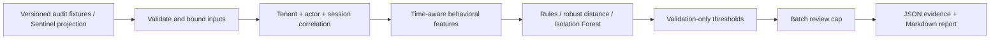

# AI Agent Behavioral Anomaly Evaluation

A reproducible, offline research system for evaluating suspicious behavior in structured AI-agent audit events. It compares an interpretable rule baseline, robust statistical distance and Isolation Forest under a fixed analyst review budget. **Synthetic evidence only; anomalies are not confirmed attacks.**

## Run offline

Python 3.12 or later. Install once, then the experiment requires no network, cloud account or API credentials:

```sh
python3 -m venv .venv
.venv/bin/python -m pip install -r requirements.txt
.venv/bin/python -m agent_anomaly
```

The last command creates `artifacts/results.json` and `artifacts/report.md`. Repeated runs in the same pinned environment produce identical artifacts. Installation requires package access; “offline” describes execution after installation.

## Architecture



`agent_anomaly.ingestion` reads bounded JSONL and projects Sentinel envelopes; `features` isolates history by tenant and actor; `data` generates overlapping behavior populations; `detectors` fits without labels; `evaluation` calculates ranking, review workload, group metrics and uncertainty; the CLI orchestrates time-separated experiments. This package does not implement authentication, policy enforcement or a cloud detection engine.

## Measured synthetic results

1,200 held-out sessions, including 64 generated anomalies. Thresholds use unlabelled validation only; final alerts are capped at 24 per batch.

| Detector | AP | Precision | Recall | False alerts / 1,000 | Alerts |
|---|---:|---:|---:|---:|---:|
| Rule reference | 0.384 | 0.786 | 0.172 | 2.50 | 14 |
| Robust distance | 0.389 | 0.733 | 0.172 | 3.33 | 15 |
| Isolation Forest | 0.253 | 0.412 | 0.109 | 8.33 | 17 |

The forest does not justify promotion over the simpler methods in the held-out experiment. Robust distance has slightly higher AP, while rules yield fewer false alerts at the calibrated operating point. Rules remain the predeclared interpretable reference. Under drift, the forest recovers more positives at the cost of extra false alerts. **Unseen sequence recall is 0.019 for rules and zero for both challengers**: this feature set does not establish useful detection of that family.

[Calculated report](evaluation/v2/report.md) and [complete JSON](evaluation/v2/results.json) contain ROC-AUC, AP, precision/recall at 1%, 2%, and 5% budgets, per-scenario/population breakdowns, confidence intervals, drift warnings and false-positive/negative feature evidence. A validation quantile never guarantees a future false-positive rate.

## Sequence-aware follow-up

A separate, predeclared follow-up fits an actor-scoped, smoothed first-order transition-deviance baseline and compares all four detectors on **fresh chronological test instances**, keeping the v2 results above intact.

On 1,200 fresh sequence-test sessions (54 anomalies), the new baseline achieves **AP 0.515**, **recall 0.278**, and **precision 0.625**: 15 true and 9 false alerts at the 24-alert cap. Existing detectors have zero calibrated recall on the same sessions. At an equal 24-session ranking budget, recall is 0.000 for rules, 0.074 for robust distance, 0.037 for Isolation Forest, and 0.278 for the new baseline.

The improvement is limited: it misses all 16 reader-population sequence anomalies, produces more false alerts, and performs worse than the existing methods on a fresh mixed-scenario batch (AP 0.182 versus 0.378/0.472/0.345). This supports a specialized sequence baseline, without replacing the general reference. Fresh instances of an inspected family do not establish blind unseen-family generalization.

```sh
.venv/bin/python -m agent_anomaly.sequence_experiment --output artifacts/sequence
.venv/bin/python scripts/verify_sequence_results.py artifacts/sequence/results.json --reference evaluation/sequence-v1/results.json
```

[Sequence methodology and leakage controls](docs/SEQUENCE_BASELINE.md), [calculated report](evaluation/sequence-v1/report.md), and [full results](evaluation/sequence-v1/results.json) include the fixed design, paired actor-cluster uncertainty, drift/mixed controls, per-population misses and count-preserving order diagnostic.

## Combined rules-plus-sequence follow-up

A fixed maximum of validation-scaled rules and sequence scores feeds **one shared queue**, capped at 24 unique sessions per 1,200-session batch. A new mixed held-out set includes all four anomaly families; independent sequence/non-sequence controls expose the tradeoffs.

| Primary fresh mixed set (62 anomalies) | AP | True / false alerts | Recall |
|---|---:|---:|---:|
| Rules | 0.201 | 5 / 9 | 0.081 |
| Sequence | 0.275 | 12 / 12 | 0.194 |
| Combined | 0.393 | 11 / 8 | 0.177 |

Combination improves AP and precision here, but loses recall versus sequence alone. At exactly 24 reviews, sequence and combination tie at 12 true / 12 false alerts, while covering different scenarios. The combined threshold admits only 19 alerts; the shared cap is not binding. **All 9 primary reader-sequence anomalies remain missed**, as do all 27 in the sequence control. Fusion is not promoted over the existing reference.

```sh
.venv/bin/python -m agent_anomaly.combined_experiment --output artifacts/combined
.venv/bin/python scripts/verify_combined_results.py artifacts/combined/results.json --reference evaluation/combined-v1/results.json
```

[Combined methodology and tradeoffs](docs/COMBINED_BASELINE.md), [calculated report](evaluation/combined-v1/report.md), and [full results](evaluation/combined-v1/results.json) document the frozen design, score scales, single cap, gained/lost detections, reader misses, equal-workload reviews and uncertainty. These are new instances of inspected synthetic families.

## Reader investigation and population-aware calibration

A further fixed-design experiment derives behavioral groups from **training tool frequencies**, calibrates within tenant/group using unlabelled validation, and keeps **one shared 24-session cap**. It never uses the generator's population labels or actor-name parsing for grouping.

On a new mixed set of 1,200 sessions and 52 anomalies, population calibration finds **7 true / 7 false alerts**, versus global fusion **8 / 7**. AP moves from 0.371 to 0.380, while recall falls from 0.154 to 0.135. At exactly 24 reviews, results are 14 true / 10 false versus 15 / 9. **All 13 reader-sequence anomalies remain missed**, as do all 13 in the new sequence-only control. The candidate fails its reader-recovery objective; no reference is promoted.

The investigation documents weaker reader transition scores, substantial overlap with benign behavior, and small contaminated local validation tails that can raise reader thresholds. Historical diagnostics and fresh evaluation remain separate.

```sh
.venv/bin/python -m agent_anomaly.population_experiment --output artifacts/population
.venv/bin/python scripts/verify_population_results.py artifacts/population/results.json --reference evaluation/population-v1/results.json
```

[Investigation and leakage controls](docs/POPULATION_CALIBRATION.md), [calculated report](evaluation/population-v1/report.md), [full results](evaluation/population-v1/results.json), and [historical diagnostic evidence](evaluation/population-v1/investigation.json) include support/fallback policies, tenant isolation, reader examples, group allocation, matched-workload controls and displacement tradeoffs.

## Scenarios and trust boundaries

The generator includes denial probing, export concentration, frequency shifts, and held-out reordered tool sequences. Reader, operator and batch populations can legitimately export, request administrative tools, incur denials and operate quickly. These overlaps create benign alert candidates and prevent an attack-only tool shortcut. New tenant/actor/tool relationships are exposed as novelty evidence; they are not verified attack coverage. Policy-change and privileged-boundary hypotheses require source context beyond an anomaly score.

[Methodology, data specification, source compatibility and privacy boundaries](docs/METHODOLOGY.md) document chronological splits, contaminated training, label isolation, frozen actor history, imbalance, uncertainty and limitations. Required audit fields are `schema_version=1`, `tenant`, `actor`, `session`, `event_id`, timezone-aware `at`, `tool`, and `outcome`. Arbitrary payloads are discarded. The Sentinel adapter requires explicit caller session correlation and trusts supplied audit authenticity. Never publish real audit identifiers or tool arguments.

## Historical evidence

The [original held-out evaluation](docs/HISTORICAL_BASELINE.md) remains unchanged: sensitive-action rate AP **0.1849** exceeds Isolation Forest AP **0.1062**. Original artifacts remain under `evaluation/`. Reproduce with `.venv/bin/python evaluate.py --output artifacts/historical.json`.

The [legacy notebook](legacy/research/agent_anomaly_detection.ipynb) used in-sample evaluation and known contamination. Its approximately 0.99 and 0.75 ROC-AUC observations are historical research, not held-out detector performance. The new generator and features are different; their scores are not a longitudinal performance improvement claim.

## Verify

```sh
.venv/bin/python -m pip install -r requirements-dev.lock
.venv/bin/python -m coverage run -m unittest -v
.venv/bin/python -m coverage run --append -m agent_anomaly.sequence_experiment --output artifacts/sequence
.venv/bin/python -m coverage run --append -m agent_anomaly.combined_experiment --output artifacts/combined
.venv/bin/python -m coverage run --append -m agent_anomaly.population_experiment --output artifacts/population
.venv/bin/python -m coverage report
.venv/bin/python -m ruff check agent_anomaly test_audit.py test_sequence.py test_combined.py test_population.py scripts
.venv/bin/python -m ruff format --check agent_anomaly test_audit.py test_sequence.py test_combined.py test_population.py scripts
.venv/bin/python -m bandit -r agent_anomaly scripts -q
.venv/bin/python -m pip_audit -r requirements.txt --no-deps --disable-pip
.venv/bin/python -m agent_anomaly --output artifacts/replay
```

Tests exercise invalid types/timestamps/schema, payload exclusion, tenant isolation, duplicate and out-of-order events, volume/session limits, missing model state, nonfinite features, contaminated training, frozen history, label independence and budget edges. Coverage enforces 75% across library modules; the CLI is verified by full deterministic replay. CI also validates generated metric/count invariants and compares two runs. Dependency scanning needs network access. See [verification workflow](.github/workflows/evaluation.yml).

## Operational limitations

No real-world efficacy, calibrated attack probability, online incident latency or enterprise readiness is claimed. Completed-session scoring delays detection until session closure. Fixed frozen profiles can age badly; concept drift requires review and recalibration. The transition feature is coarse, and the unseen-family result is poor. Synthetic labels and fixed generator assumptions limit all reported metrics. Session bootstrap intervals understate uncertainty from repeated actors and generator design. Batch processing is bounded, but there is no streaming service, model registry or production deployment.

The portfolio value is the measured comparison, reproducibility and explicit failure analysis. [MIT license](LICENSE). [Security reporting](SECURITY.md).
